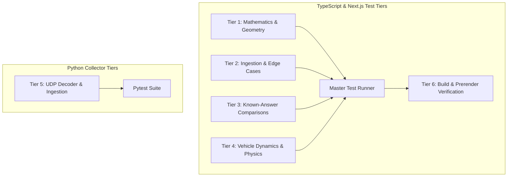

# APEX TELEMETRY 3D — VERIFICATION & TEST PLAN

**Project:** ApexMotion Telemetry Lab 3D  
**Document Revision:** 1.0.0  
**Verification Standard:** ISO/IEC/IEEE 29119 Software Testing & FIA Telemetry Alignment Guidelines  
**Scope:** Automated mathematical, numerical, data ingestion, vehicle dynamics, UDP decoding, and regression suites.

---

## 1. Executive Summary & Verification Strategy

The verification strategy of **ApexMotion Telemetry Lab 3D** is structured around deterministic, repeatable automated testing that strictly separates:
1. **Mathematical correctness**: Invariant preservation in spline interpolation, coordinate frame transformations, and floating-point tolerances.
2. **Data ingestion integrity**: Schema conformance, physical bounds checking, monotonicity, and anomaly detection.
3. **Numerical comparative analysis**: Distance alignment, trapezoidal time-delta calculations, and interpolation bounding.
4. **Physical simulation realism**: Dimensional consistency ($F=ma$), aero drag scaling ($v^2$), DRS aerodynamic effects, and Euler integration stability.
5. **Real-time networking**: UDP packet decoding, struct unpacking safety, truncation protection, and endianness handling.
6. **Application build stability**: Production compilation, static page generation, and TypeScript type soundness across all 21 routes.

---

## 2. Test Tier Architecture

---

## 3. Detailed Test Catalog

### Tier 1: Core Mathematics & Spline Interpolation (`tests/physics_and_replay.test.ts`)
* **Objective:** Ensure geometric continuity, spatial normalization, and delta string representation accuracy.
* **Test Cases:**
  1. `Track Generator Spline Interpolation`: Catmull-Rom closed splines produce smooth, continuous track loops where start and end coordinates coincide within $10^{-4}\text{ m}$.
  2. `Bounding Box & Coordinate Transformation`: Track coordinate bounds compute valid $(X_{\min}, X_{\max}, Z_{\min}, Z_{\max})$ spans; normalization scales the circuit to fit the 3D viewport without aspect distortion.
  3. `Time & Delta Formatting Sign Conventions`: Strict sign adherence where negative values represent lap time advantage ($-\Delta t$, green), and positive values represent lap time deficit ($+\Delta t$, red).
  4. `Longitudinal Dynamics & RPM Step`: Gear ratio stepping and engine speed calculations remain within physical combustion engine boundaries ($4,000 \le \text{RPM} \le 15,000$).

### Tier 2: Phase Three — Telemetry Data Validation & Edge Cases (`tests/validation.test.ts`)
* **Objective:** Validate real-world CSV files, reject corrupt inputs, and report diagnostics without silent data mutation.
* **Test Cases:**
  1. `Clean Valid CSV Ingestion`: Ingests clean multi-channel telemetry, producing zero validation errors and valid summaries.
  2. `Empty File Rejection`: Empty CSV string triggers a fatal `NO_RECORDS` error with an intelligible error code.
  3. `Missing Mandatory Channel Detection`: Omitting required channels (e.g. `SpeedKph` or `Timestamp`) triggers a fatal `MISSING_CHANNELS` error and lists the exact missing fields.
  4. `Non-Monotonic Timestamp Fatal Error`: Timestamps that regress ($t_{k+1} < t_k$) trigger fatal validation failure to prevent replay clock instability.
  5. `NaN & Infinity Floating Point Protection`: Non-finite values in numerical channels are caught and logged as non-recoverable errors.
  6. `Sampling Gap Detection (>1.0s)`: Identifies sensor dropouts exceeding 1.0 second and produces an actionable warning with exact timestamps.
  7. `Semicolon Delimiter Auto-Detection`: European CSV format (semicolon-delimited) is cleanly identified and parsed identically to standard comma-delimited streams.

### Tier 3: Phase Six — Lap Alignment & Known-Answer Comparisons (`tests/comparison.test.ts`)
* **Objective:** Verify distance-based spatial alignment and delta time calculations against analytical ground truth.
* **Tolerance Threshold:** Cumulative lap delta tolerance $\epsilon \le 10^{-4}\text{ s}$.
* **Test Cases:**
  1. `Comparison Test A (Identical Data)`: Comparing a lap against itself must yield identically zero delta time ($\Delta t(s) = 0.0000\text{ s}$) at every spatial grid point.
  2. `Comparison Test B (Constant Offset)`: Reference car at constant $50\text{ m/s}$ vs comparison car at constant $40\text{ m/s}$ over $1,000\text{ m}$. Analytical delta time $\Delta t = \frac{1000}{40} - \frac{1000}{50} = 25 - 20 = +5.0000\text{ s}$. Test asserts computed delta matches $5.0000\text{ s}$ within $\pm 0.001\text{ s}$.
  3. `Comparison Test C (Incomplete Overlap Bounding)`: Reference lap spans $0\text{--}400\text{ m}$, comparison lap spans $0\text{--}300\text{ m}$. Interpolation safely truncates comparison at $300\text{ m}$ without extrapolating beyond observed data.
  4. `Comparison Test D (Large Gap Protection)`: Missing data gap exceeding $150\text{ m}$ triggers interpolation gap protection and prevents false delta calculations.
  5. `Comparison Test E (Insufficient Samples)`: Datasets with fewer than 2 valid spatial points are safely rejected with an explicit error.

### Tier 4: Phase Seven — Longitudinal Dynamics & Dimensional Physics (`tests/dynamics.test.ts`)
* **Objective:** Verify adherence to classical mechanics and aerodynamic principles.
* **Test Cases:**
  1. `F_net = m * a Dimensional Verification`: Net force equals mass times longitudinal acceleration ($F_{\text{net}} = m \cdot a$) across throttle and braking regimes within $0.01\%$ numerical precision.
  2. `Mass Proportionality`: Doubling vehicle mass at identical net tractive force exactly halves acceleration ($a_2 = 0.5 \cdot a_1$).
  3. `Quadratic Aero Drag Scaling`: Aerodynamic drag force scales strictly with the square of velocity:
     $$\frac{F_{\text{drag}}(2v)}{F_{\text{drag}}(v)} = 4.0 \pm 0.001$$
  4. `DRS Flap Drag Reduction`: Drag Reduction System activation reduces drag coefficient $C_d$ by exactly $26.0\%$, verified through net resistive force comparisons.
  5. `Semi-Implicit Euler Kinematic Integration`: Integration step ensures velocity and position update deterministically without energy injection or numerical divergence:
     $$v_{k+1} = v_k + a_k \cdot \Delta t, \quad x_{k+1} = x_k + v_{k+1} \cdot \Delta t$$

### Tier 5: Python Collector UDP Packet Decoding (`python-collector/tests/test_packet_decoder.py`)
* **Objective:** Ensure robust network telemetry decoding from F1 simulator binary datagrams.
* **Test Cases:**
  1. `test_valid_telemetry_packet_unpacking`: Valid 28-byte telemetry datagram unpacks correctly to speed, throttle, brake, gear, and engine RPM.
  2. `test_valid_lap_packet_unpacking`: Valid 18-byte lap datagram unpacks lap distance, lap time, and lap index.
  3. `test_short_truncated_packet_rejection`: Truncated datagram shorter than header size is rejected safely without crashing the UDP listener loop.
  4. `test_nan_float_rejection`: Datagrams containing IEEE 754 NaN or Infinite bit patterns are detected and discarded.
  5. `test_unknown_packet_id`: Packets with unrecognized header packet IDs are dropped without interrupting socket polling.
  6. `test_telemetry_normalizer_envelope`: Normalizer converts raw unpacked structs into clean, schema-compliant JSON telemetry envelopes for WebSocket broadcast.

### Tier 6: Next.js Production Build & Static Prerendering
* **Objective:** Ensure TypeScript type soundness and complete prerendering across all routes.
* **Scope:** 21 routes (`/`, `/dashboard`, `/historical`, `/connection`, `/data`, `/explore`, `/timing`, `/comparison`, `/replay`, `/telemetry`, `/tyres`, `/track-map`, `/drivers`, `/history`, `/laps`, `/packets`, `/diagnostics`, `/about`, `/_not-found`).

---

## 4. Execution Commands & Test Matrix

| Tier | Environment | Command | Duration | Passing Target | Current Status |
| :--- | :--- | :--- | :--- | :--- | :--- |
| **Tiers 1–4** | Node.js / tsx | `npm test` | ~1.4s | 21 / 21 | **100% PASSED** |
| **Tier 5** | Python 3.14 / pytest | `cd python-collector; pytest -v` | ~0.6s | 6 / 6 | **100% PASSED** |
| **Tier 6** | Next.js Turbopack | `npm run build` | ~6.5s | 21 / 21 routes | **100% PASSED** |

---

## 5. Maintenance & Continuous Verification

1. **Pre-commit Rule**: All test tiers must be run prior to committing changes to `main`.
2. **Deterministic Seed**: Simulation randomness must be strictly bounded or seeded to preserve reproducibility.
3. **No Mocks for Physical Truth**: Ground truth tests (Tests A–E, Physics 1–5) must compute analytical values directly rather than comparing against mocked outputs.
